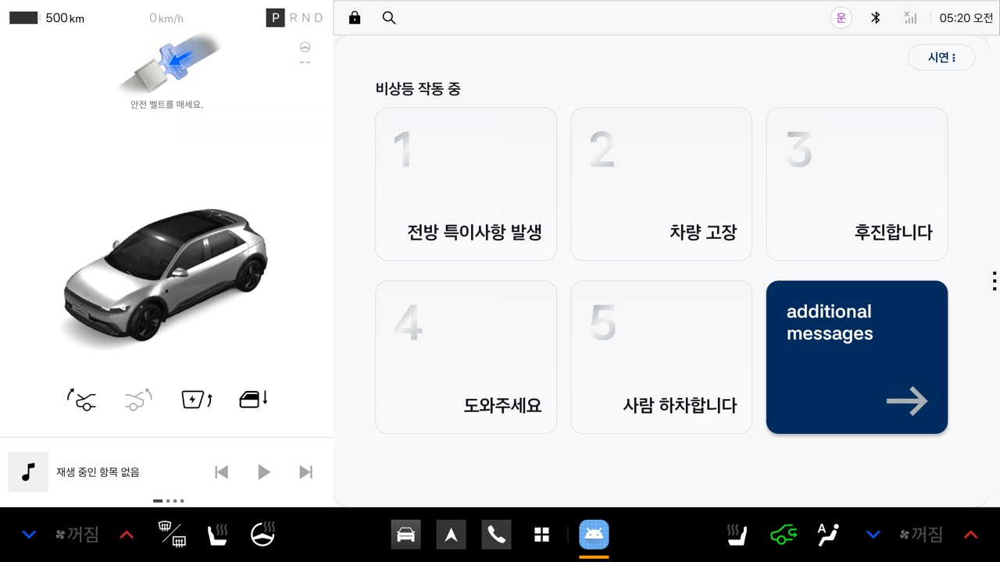
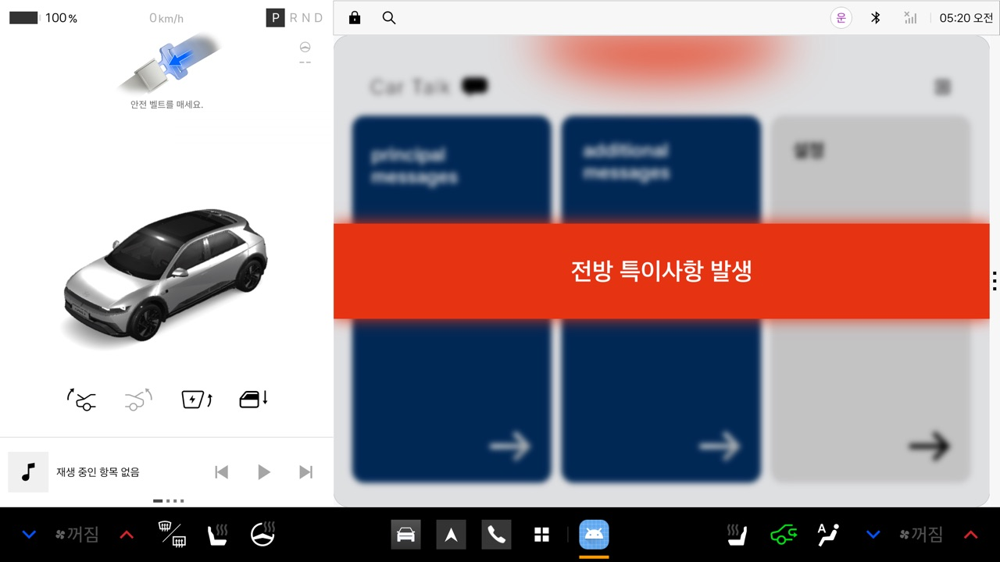
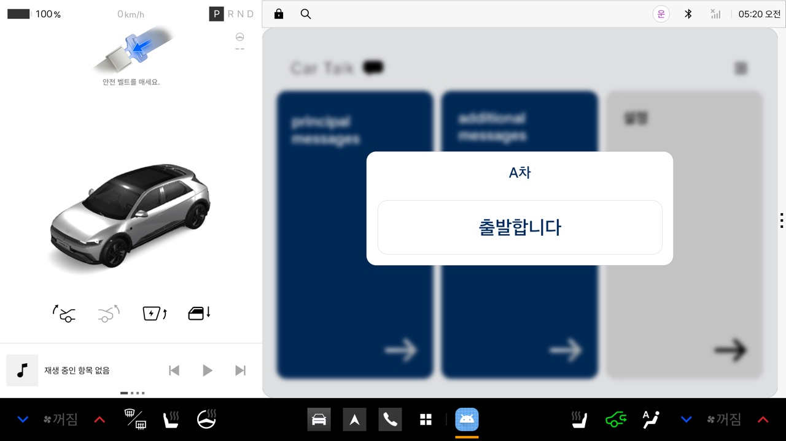

# Car Talk

깜빡이 뒤에 숨은 의도를, 한 문장의 메시지로.
방향지시등·비상등·메시지 버튼 조작에 맞춰 정형 메시지를 고르면, 주변 차량 앱에 화면과 음성으로 전달되는 Pleos Connect 앱.

> 현대자동차그룹 차량용 앱 개발 공모전 출품작

**빠르게 보기:** [`apk/길위의친구들_CarTalk_release.apk`](apk/길위의친구들_CarTalk_release.apk)를 Pleos Connect 에뮬레이터에 설치하고 앱 아이콘으로 열면, 서버 없이 화면 흐름을 보는 시연 모드로 열린다(오른쪽 위 `시연` 메뉴). 두 차 사이 실제 전달은 [실행 방법](#실행-방법), 자세한 안내는 [APK](#apk).

## 화면

| A차: 비상등을 켜면 뜨는 후보 | B차: 비상등 메시지 수신 | B차: 방향지시등 메시지 수신 |
|---|---|---|
|  |  |  |

Pleos Connect Emulator 2.1.0(2560×1440) 두 대가 중계 서버를 거쳐 주고받은 실제 화면이다. 받은 메시지는 음성으로도 읽어 준다.

## 주요 개발 범위 (1차)

1차 시연 장면 두 개가 Pleos 에뮬레이터 두 대에서 끝까지 동작한다.

- **장면 1:** A차가 왼쪽 깜빡이를 켜고 "출발합니다"를 고르면 → B차에 카드와 음성
- **장면 2:** A차가 비상등을 켜고 "전방 특이사항 발생"을 고르면 → B차에 빨간 경고와 음성

"시연 대체"는 동작은 하지만, Pleos API가 없거나 에뮬레이터에서 동작하지 않아 실제 차량과 다른 방식으로 구현한 것이다 ([아래](#pleos-sdkapi)).

| 기능 | 상태 | 구현 위치 |
|---|---|---|
| 좌회전 깜빡이 → 후보 목록 (좌회전합니다·유턴합니다·출발합니다) | ✅ 동작 (Vehicle SDK) | `fe` CarDevices.kt |
| 비상등 → 후보 목록 (주요 1~5번, 추가 6~10번) | ✅ 시연 대체 (adb 신호) | `fe` CarDevices.kt |
| 터치로 고르기 → 확인창 → 전송 → 전송 완료 | ✅ 동작 | `fe` MessagingController.java, MessageBoard.kt |
| 말로 고르기 ("N번 메시지 보내줘") | ✅ 시연 대체 (맥 음성 인식) | `bridge`, `fe` |
| 차량 간 전달 + 수신 확인(ack) | ✅ 동작 | `fe` WebSocketMessageGateway.kt, `be` Relay.kt |
| 수신 알림 (비상등 주요 메시지는 빨간 경고, 나머지는 흰 카드, 여러 개면 대기열) | ✅ 동작 | `fe` MessagingController.java |
| 받은 메시지 읽어 주기 | ✅ 시연 대체 (맥 음성) | `fe` CarDevices.kt(HostSpeaker), `bridge` |
| 전송 실패 → 재전송 (같은 id라 중복 수신 없음) | ✅ 동작 (재전송 창까지 앱에서 확인, 중복 방지는 서버 테스트) | `fe`, `be` |
| 연결 끊김 → 재접속, 전송 중이던 메시지 같은 id로 재전송 | 코드 완료, 앱 시험 전 | `fe` WebSocketMessageGateway.kt |
| 핸들(말하기) 버튼 | 코드 완료, 실물 연결 전 (키보드로 대신) | `firmware`, `bridge` |
| 서버 없이 화면 흐름만 보는 시연 모드 (서버 주소를 주지 않으면 기본) | ✅ 동작 | `fe` MainActivity.kt, DemoMessageGateway.kt |
| 우측 깜빡이 화면, 좁은 길 양보·답장(장면 3) | 미구현 (코드표에는 있음) | — |

## 아키텍처

```
A차 입력  ─ 깜빡이: Virtual Console → Vehicle SDK
          ─ 비상등: adb broadcast
          ─ 핸들 버튼·들은 말: 아두이노 → 맥 음성 브리지 → adb broadcast
   │
   ▼
A차 앱    CarSignals → MessagingController(후보 화면·확인창) → WebSocketMessageGateway
   │ send   ▲ status (delivered / failed)
   ▼        │
중계 서버 be/ Ktor WebSocket: 코드만 전달, ack 3초 대기, 같은 id 중복 방지
   │ msg    ▲ ack
   ▼        │
B차 앱    WebSocketMessageGateway → 수신 카드·빨간 경고
          HostSpeaker → POST /speak → 맥 음성 브리지 → 스피커
```

- A차와 B차는 **같은 APK**다. 내 차 ID(`A`/`B`)만 다르게 설정한다.
- 차량끼리 직접 통신하는 API가 없어서 서버가 중계한다. 서버는 메시지 **코드**(`DEPART` 등)만 넘기고, 화면 문구·읽을 문장은 받는 앱이 코드표(`docs/messages.json`, 23개)에서 꺼낸다.
- **1차 시연:** 맥 한 대에 에뮬레이터 2대 + 중계 서버 + 음성 브리지.
  **2차 PT:** 노트북 2대(차마다 하나, 각자 음성 브리지) + AWS 중계 서버. 앱은 서버 주소 설정값만 바꾼다.
- 규약 전체는 [`docs/protocol.md`](docs/protocol.md)(앱 ↔ 서버), [`docs/device-signals.md`](docs/device-signals.md)(앱 ↔ 차량 신호·브리지).

## Pleos SDK·API

### 쓰는 것

| SDK·API | 쓰는 곳 | 내용 |
|---|---|---|
| **Pleos Vehicle SDK 2.3.2** | `fe` CarDevices.kt | `Vehicle.getTurnSignal().registerTurnSignalState()`로 방향지시등 구독 (값 `LEFT` / `RIGHT` / `OFF`). 권한 `pleos.car.permission.CAR_LIGHTS`. 실제 차량에서도 그대로 쓴다 |
| Pleos Virtual Console | 시연 | 에뮬레이터의 차량 신호(방향지시등 등)를 브라우저에서 조작 |
| Android 표준 | `fe` | 실행 중 등록하는 BroadcastReceiver(adb 신호), OkHttp WebSocket |

### 막혀서 대체한 것

팀이 11/9·11/13에 Pleos Connect 에뮬레이터 2.1.0과 개발자 콘솔에서 직접 확인한 결과다.

| 기능 | Pleos에서 막힌 것 | 지금 시연 구현 | 실제 차량에서는 |
|---|---|---|---|
| 받은 메시지 읽어 주기 (TTS) | TextToSpeech 3.3.1: 콘솔 "준비 중", 에뮬레이터에서 `ON_DEVICE_ENGINE_ERROR` | 앱 → `POST /speak` → 맥 음성(say) | Pleos TTS SDK. `HostSpeaker` 자리만 교체 |
| 말로 고르기 (STT) | SpeechToText 3.3.1: 같은 상태 | 맥 마이크 → faster-whisper 인식 → adb `VOICE_RESULT` | Pleos STT SDK. 앱의 입력 자리(`recognize(text)`)는 그대로 |
| 핸들(말하기) 버튼 | 스티어링 휠 음성 버튼 API 없음 (공개된 건 미디어 키·CCP Back 키) | 아두이노 버튼 → 맥 브리지 → adb `PTT` | 버튼 API가 열리면 그것, 아니면 미디어 키·화면 버튼 |
| 비상등 감지 | Vehicle SDK(19개 영역)에 비상등 없음 | adb `HAZARD` 신호 | 비상등 API가 열리면 그것, 또는 Android Automotive 표준 `HAZARD_LIGHTS_STATE` |
| 차량 간 통신 | V2X·푸시·메시징 API 없음 | 자체 중계 서버 (WebSocket) | 같은 구조를 이동통신망으로. 인증·차량 식별 추가 |
| 받을 차 정하기 | 위치 SDK(FusedLocation) "준비 중" | 서버에 접속한 다른 차 전원 | 반경 내 차량, 또는 번호판 인식으로 지정 |
| HUD(앞유리) 표시 | HUD·계기판 표시 API 없음 | 인포테인먼트 화면의 카드 + 음성 | HUD API가 열리면 HUD |

## 설계 결정 (개발자 관점)

- **앱은 신호가 어디서 오는지 모른다.** Vehicle SDK·adb·브리지 신호는 `CarSignals` 한 곳에서 앱 이벤트로 바뀌고, 읽기는 `HostSpeaker` 한 곳에서 나간다. Pleos API가 열리면 이 두 곳만 바꾸면 되고, 화면·상태 코드는 그대로다. 시연용과 실차용이 같은 APK가 되는 이유다.
- **정해진 문구만, 반드시 확인창을 거쳐 보낸다.** 운전 중 자유 입력을 없애고, 터치로 골라도 말로 골라도 같은 "선택" → 확인창을 거쳐 잘못 고른 메시지가 바로 나가지 않게 했다.
- **주행 중 통신이 끊기는 것을 전제로 한다.** 메시지마다 UUID를 붙이고, 받은 차의 ack로 3초 안에 결과(전송 완료/실패)를 확정한다. 실패하면 같은 id로 다시 보내고 서버가 중복 전달을 막는다. 끊기면 1초 → 최대 10초 간격으로 재접속하고, 전송 중이던 메시지를 같은 id로 다시 보낸다.
- **서버는 코드만 전달하고 아무것도 저장하지 않는다.** 문구는 받는 앱이 코드표에서 찾으므로 문구를 바꿔도 서버는 그대로다. 상태는 메모리에만 두고 DB가 없어서, 위치·대화 기록이 남지 않는다.
- **서버는 Kotlin + Ktor.** 앱과 같은 언어이고, WebSocket 중계만 하는 작은 서버라 무거운 프레임워크 대신 가벼운 Ktor를 골랐다. 규약 흐름(정상, 받을 차 없음, 시간 초과, 재전송, 끊긴 뒤 재전송, 전원 전송, 답장, 형식 오류)을 테스트 8개로 검증한다.

## 추후 개발 계획

### 2차 PT(12/3~4) 전

| 순서 | 기능 | 내용 |
|---|---|---|
| 0 | 확인까지 음성으로 | 확인창에서도 핸들 버튼 + "확인"·"취소"를 알아듣게 해서 운전 중 터치를 없앤다 |
| 1 | 번호판 인식 | 라즈베리파이 카메라로 앞차 번호판을 읽어 메시지를 받을 차를 정한다 (번호판 ↔ 차량 ID 연결, 규약 변경) |
| 2 | 핸들 버튼 실물 | 아두이노를 맥 브리지에 연결 (코드는 완료) |
| 3 | HUD 대체 | 받은 메시지를 앞유리 HUD처럼 보여 주는 웹 화면 |
| — | 중계 서버 | AWS 배포, 암호화(`wss://`), 접속 인증 |

### 그다음

- 문구로 고르기 ("출발합니다 보내줘"). 지금은 번호로만 고른다
- 우측 깜빡이 화면, 좁은 길 양보·답장 장면 (버튼 코드 7개, `replyTo`는 서버가 이미 지원)
- 주변 반경(예: 300m) 차량에만 보내기 (위치 SDK가 열리면)
- 실차 전환: Pleos STT·TTS·비상등 API가 열리면 `CarSignals`·`HostSpeaker`만 교체

### 알려진 한계

- 서버에 인증이 없고 저장소가 공개라, 누군가 같은 차량 ID로 접속하면 기존 연결이 끊긴다. 2차 PT 전에 추측하기 어려운 ID나 접속 토큰을 쓴다
- 비상등은 대체 신호라 Virtual Console의 비상등과 앱 신호를 따로 켜야 한다 (에뮬레이터 제한으로 자동 연동 불가)
- 음성 인식은 주변 소음에 약하다. 알아듣지 못하면 터치로 고른다

## 폴더 구조

```
car-talk/
├── fe/                       Pleos Connect 앱 (Android, Kotlin·Java, 패키지명 com.hyundaiproject.messaging)
│   └── app/src/main/java/com/hyundaiproject/messaging/
│       ├── MainActivity.kt               시작점, 설정값(차 ID·서버 주소), 차량 신호 → 화면
│       ├── MessageBoard.kt               화면 (Figma 시안)
│       ├── MessagingController.java      화면 상태 (선택·확인창·전송·수신 알림)
│       ├── MessageCatalog.java           메시지 목록 (messages.json과 같은 코드)
│       ├── WebSocketMessageGateway.kt    중계 서버 연결
│       └── CarDevices.kt                 차량 신호(Vehicle SDK·adb), 음성 읽기(/speak)
├── be/                       메시지 중계 서버 (Kotlin, Ktor)
│   └── src/main/kotlin/carmessage/
│       ├── Application.kt    서버 시작, /ws/{vehicleId} 접속 처리
│       ├── Protocol.kt       앱과 주고받는 메시지 형식
│       └── Relay.kt          중계 로직 (ack 3초 대기, 재전송, 답장)
├── docs/
│   ├── protocol.md           앱 ↔ 서버 규약 ← 앱 개발 전에 필독
│   ├── messages.json         메시지 코드표 (코드 → 문구, 트리거)
│   └── device-signals.md     앱 ↔ 차량 신호·맥 음성 브리지 (adb, 아두이노)
├── bridge/                   맥 음성 브리지: 아두이노 버튼·음성 인식·읽기 (사용법은 bridge/README.md)
├── firmware/                 아두이노 핸들 버튼
├── plate/                    번호판 카메라 데모 (라즈베리파이)
├── infra/                    서버 배포 (예정)
└── apk/                      제출용 release APK
```

`fe/`와 `be/`는 서로 독립된 Gradle 프로젝트다. Android Studio에서는 저장소 루트가 아니라 `fe/`를 연다.

## 개발 환경

| 도구 | 버전 | 필요한 사람 | 비고 |
|---|---|---|---|
| Git | — | 전원 | |
| JDK | **21** | 서버·앱을 빌드하는 사람 | 서버(`be/`)는 21 이상 아무거나. 앱(`fe/`)은 Gradle 8.11이라 17~23만 된다 (Android Studio 최신 내장 JDK 25는 앱 빌드에 못 씀) |
| Android Studio | 최신 | 앱 | |
| Pleos Connect Emulator | 2.1.0 (AAOS, API 34) | 앱 | Apple Silicon 맥은 ARM64 이미지 |
| Android 프로젝트 설정 | minSdk 28 이상, Gradle 8 이상 | 앱 | 공모전 요건 |
| Python | **3.12** | 맥 음성 브리지 | 3.14 이상은 음성 인식 라이브러리가 설치되지 않는다. 읽기 전용(`--speak-only`)은 표준 라이브러리만 써서 버전 상관없음 |

Gradle·Kotlin·Ktor는 따로 설치하지 않는다. `./gradlew`가 처음 실행될 때 알아서 받는다 (첫 실행만 몇 분).

### Pleos 개발자 등록 (앱 담당)

1. [developers.pleos.ai](https://developers.pleos.ai) 가입 → Pleos Playground에서 프로젝트 생성
2. Vehicle SDK(방향지시등 조회)·NaviHelper SDK는 신청 없이 바로 사용 가능
3. TTS·STT SDK는 콘솔에 아직 "준비 중"이고, 에뮬레이터에서는 엔진 오류(`ON_DEVICE_ENGINE_ERROR`)가 난다 → 시연은 맥 음성 브리지가 듣고 읽는다 ([`docs/device-signals.md`](docs/device-signals.md), 위 [Pleos SDK·API](#pleos-sdkapi))
4. 에뮬레이터 설치, Virtual Console(차량 신호 시뮬레이션) 사용법은 같은 사이트 가이드를 따른다

## 실행 방법

### 1. 받기

```bash
git clone git@github.com:SongSeungYun/car-talk.git
cd car-talk
```

SSH 키가 없으면 `https://github.com/SongSeungYun/car-talk.git`로 받는다.
디자인(Figma)·기획 문서 링크는 공개 저장소에 두지 않으니 팀 채널에서 받는다.

### 2. 서버 띄우기

```bash
cd be
./gradlew run              # ws://localhost:8080/ws/{vehicleId}
PORT=18080 ./gradlew run   # 8080이 이미 쓰이고 있을 때
./gradlew test             # 테스트
```

JDK를 따로 안 깔았다면 Android Studio 내장 JDK로 실행한다.

```bash
JAVA_HOME="/Applications/Android Studio.app/Contents/jbr/Contents/Home" ./gradlew run
```

### 3. 앱 빌드·설치

에뮬레이터 두 대가 켜져 있어야 한다 (아래 [테스트 환경](#테스트-환경)).

```bash
cd fe
./gradlew :app:assembleDebug
adb -s emulator-5554 install -r app/build/outputs/apk/debug/app-debug.apk
adb -s emulator-5556 install -r app/build/outputs/apk/debug/app-debug.apk
```

처음 실행할 때 차 ID와 서버 주소를 넘긴다. 한 번 넘기면 저장되어, 다음부터는 앱 아이콘으로 열어도 된다.

```bash
adb -s emulator-5554 shell am start -S -n com.hyundaiproject.messaging/.MainActivity --es car A --es server ws://10.0.2.2:8080
adb -s emulator-5556 shell am start -S -n com.hyundaiproject.messaging/.MainActivity --es car B --es server ws://10.0.2.2:8080
```

| 설정 | 기본값 | 설명 |
|---|---|---|
| `car` | `A` | 내 차 ID. 두 차는 반드시 다르게 (같으면 서로 연결을 끊어낸다) |
| `server` | `demo` | 중계 서버 주소. 주지 않으면(`demo`) 서버 없이 가짜 응답으로 화면만 시연한다. 같은 맥의 서버는 `ws://10.0.2.2:8080`(`10.0.2.2`는 에뮬레이터에서 본 맥), 2차 PT는 AWS 주소 |
| `bridge` | `http://10.0.2.2:8090` | 맥 음성 브리지. 받은 메시지를 여기로 보내 읽힌다 |

### 4. 시연 (1차 장면 1·2)

1. 서버: `cd be && ./gradlew run`
2. 맥 음성 브리지: [`bridge/README.md`](bridge/README.md). 읽기만 확인할 때는 `python3 bridge/voice_bridge.py --speak-only`
3. **장면 1 (방향지시등):** A차 Virtual Console(`http://127.0.0.1:8088`)에서 Turn Signal State → Blink left
   → A차에 좌회전 목록이 뜬다 → "출발합니다" → 확인 → B차에 카드 + 맥 스피커로 읽기
4. **장면 2 (비상등):** 아래 명령 → A차에 비상등 목록 → "전방 특이사항 발생" → 확인 → B차에 빨간 경고 + 읽기
   ```bash
   adb -s emulator-5554 shell am broadcast -a com.hyundaiproject.messaging.HAZARD -p com.hyundaiproject.messaging --es state ON
   ```
5. **말로 고르기:** 핸들 버튼(아두이노, 없으면 브리지 `--keyboard`)을 누른 채 "1번 메시지 보내줘" → 확인창

신호를 끄면(Blink → Off, `state OFF`) 목록에 머물러 있던 화면은 홈으로 돌아간다. 화면 오른쪽 위 `시연` 메뉴로도 목록을 열 수 있다.

### 5. 에뮬레이터 1대로 테스트하기

B차 앱 대신 크롬으로 B차를 흉내 낼 수 있다. 주소창에 `about:blank` → F12 → Console에 붙여 넣는다.

```js
const ws = new WebSocket('ws://localhost:8080/ws/B'); // 서버 포트를 바꿨으면 여기도
ws.onmessage = e => {
  console.log('받음', e.data);
  const m = JSON.parse(e.data);
  if (m.type === 'msg') ws.send(JSON.stringify({ type: 'ack', id: m.id })); // 받으면 자동 ack
};

// A차에게 답장 보내기
ws.send(JSON.stringify({ type: 'send', id: 'b-' + Date.now(), code: 'I_YIELD', to: 'A' }));
```

## 앱 개발 시 꼭 지킬 것

기준 문서는 [`docs/protocol.md`](docs/protocol.md)다. 특히 아래는 어기면 메시지가 사라지거나 계속 실패한다.

- 메시지 `id`는 `UUID.randomUUID()`로 만든다. 1, 2, 3 같은 번호는 금지
- `msg`를 받으면 화면에 띄운 직후 `ack`를 보낸다. **같은 메시지가 두 번 와도, Additional 수신을 꺼서 화면에 안 띄워도 ack는 보낸다** (화면엔 한 번만)
- 끊기면 재접속한다 (1s → 2s → 4s … 최대 10s). "전송 중"이던 메시지는 **같은 id로** 다시 보낸다
- 문구는 서버가 아니라 `messages.json`에서 꺼낸다
- 앱 패키지명은 `com.hyundaiproject.messaging`. 비상등·핸들 버튼·음성 신호는 [`docs/device-signals.md`](docs/device-signals.md)

## 협업 규칙

- `main`에 직접 push한다 (브랜치·PR 없음).
- push 전에 `git pull --rebase`로 최신을 받는다.
- 각자 자기 폴더에서 작업한다 (`fe/` 앱, `be/` 서버). `docs/`의 규약·코드표는 앱과 서버가 같이 쓰므로 바꾸기 전에 팀에 공유한다.

## 주의: 공개 저장소

이 저장소는 Public이다. 아래는 커밋하지 않는다.

- 팀 내부 자료 (기획 PDF, Figma·내부 문서 링크, 팀원 실명)
- 서명 키(`.jks`, `.keystore`), Pleos Client Secret 같은 비밀값

대부분 `.gitignore`에 걸려 있지만, `git add` 전에 `git status`로 한 번 확인한다.

## 테스트 환경

| 항목 | 내용 |
|---|---|
| **에뮬레이터 버전** | **Pleos Connect Emulator 2.1.0** (Android Automotive OS, API 34) |
| **화면 규격** | **2560×1440** (가로) |
| 구성 | 에뮬레이터 2대. A차 `emulator-5554`, B차 `emulator-5556`, 같은 APK |
| 확인한 환경 | Apple Silicon 맥 1대에 에뮬레이터 2대 + 서버 + 음성 브리지. 장면 1·2 번갈아 10회 연속 성공 (11/11). 다른 팀원 맥에서도 터치·음성으로 장면 1·2 통과, 서버 전달 0.04초 이내 (11/13). 제출용 release APK를 새로 설치해 아이콘 실행(시연 모드)과 실제 서버 전달 확인 (11/15) |
| 앱 권한 | `INTERNET`, `pleos.car.permission.CAR_LIGHTS`(방향지시등). 둘 다 설치할 때 자동 허용된다 |
| 차량 신호 | 방향지시등은 Virtual Console → Vehicle SDK. 비상등·핸들 버튼·들은 말은 adb broadcast ([`docs/device-signals.md`](docs/device-signals.md)) |
| 음성 | Pleos STT·TTS는 에뮬레이터에서 엔진 오류가 나서, 맥 음성 브리지가 듣고 읽는다 |

### 에뮬레이터 준비 (Apple Silicon 맥, 한 번만)

1. Android Studio → SDK Manager → SDK Update Sites에 아래 주소 추가 → SDK Platforms에서 Android 14 (API 34) 아래 Pleos Connect 이미지 설치
   `https://nexus-playground.pleos.ai/repository/raw-releases/connect-avd/2.x/crp-arm64-sys-img.xml`
   (Windows·Intel PC는 끝을 `crp-sys-img.xml`로 바꾼 주소. x86_64 이미지다)
2. Device Manager → Automotive → Pleos Connect v2.1.0으로 가상 기기 2개(`Pleos`, `PleosB`). Boot는 Cold, RAM 4GB
3. 아래 명령으로 켠다. Device Manager의 재생 버튼으로 켜면 Vulkan 문제로 부팅 뒤 죽는다.
   `emulator`·`adb`는 `~/Library/Android/sdk/emulator`, `~/Library/Android/sdk/platform-tools`에 있다
   ```bash
   emulator -avd Pleos  -port 5554 -no-snapshot -gpu host -feature -Vulkan &
   emulator -avd PleosB -port 5556 -no-snapshot -gpu host -feature -Vulkan &
   adb -s emulator-5554 forward tcp:8088 tcp:8088
   adb -s emulator-5556 forward tcp:8089 tcp:8088
   ```
   Virtual Console은 A차 `http://127.0.0.1:8088`, B차 `http://127.0.0.1:8089`. **이 페이지가 브라우저에 열려 있어야** 차량 신호가 들어간다 (닫혀 있으면 `503 emulator_inactive`)
4. 깜빡이를 켜면 후측방 카메라 화면이 앱을 가리므로 차마다 한 번 끈다. `10`은 `adb -s emulator-5554 shell am get-current-user`로 나온 값
   ```bash
   adb -s emulator-5554 shell pm disable-user --user 10 ai.umos.car.evs
   ```

1차 범위와 알려진 한계는 위 [주요 개발 범위](#주요-개발-범위-1차), [추후 개발 계획](#추후-개발-계획) 참고.

## APK

[`apk/길위의친구들_CarTalk_release.apk`](apk/길위의친구들_CarTalk_release.apk) — release 빌드, 팀 키로 서명 (Pleos Connect Emulator 2.1.0에서 설치·실행 확인)

```bash
adb install apk/길위의친구들_CarTalk_release.apk
```

- **설치 후 앱 아이콘으로 바로 열면** 서버 없이 화면 흐름을 보는 시연 모드다. 오른쪽 위 `시연` 메뉴에서 비상등·좌회전 후보 목록 → 확인창 → 전송 완료, 경고 수신, 전송 실패 → 재전송, 음성으로 고르기 흐름을 볼 수 있다. 방향지시등(Virtual Console)·비상등 신호도 이 모드에서 그대로 목록을 연다.
- **두 차 사이 실제 전달까지 보기:** 위 [실행 방법](#실행-방법)대로 서버(`be/`)를 띄우고, 에뮬레이터 두 대에서 각각 `--es car A`·`--es car B`와 `--es server ws://10.0.2.2:8080`을 주어 실행한다.
- 소스에서 직접 빌드한 debug APK와는 서명이 달라서, 바꿔 설치할 때는 먼저 `adb uninstall com.hyundaiproject.messaging`.
